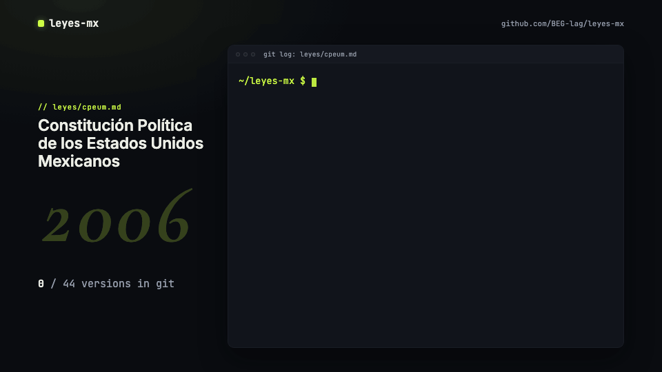
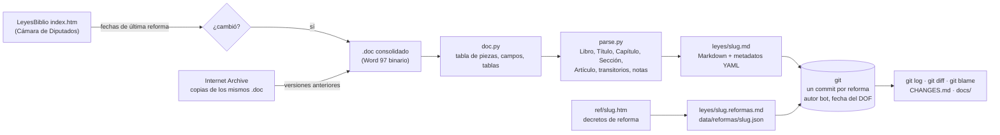

<p align="center">
  
</p>

<p align="center">
  <a href="README.md">English</a> · <b>Español</b>
</p>

<p align="center">
  <a href="https://github.com/BEG-lag/leyes-mx/actions/workflows/ci.yml"></a>
  <a href="https://github.com/BEG-lag/leyes-mx/actions/workflows/update.yml"></a>
  <a href="LICENSE"></a>
  <a href="DATA-LICENSE.md"></a>
  
</p>

<!-- demo:start -->
<p align="center">
  
</p>
<p align="center"><sub>Historia real de este repo, sin maquetas. <a href="assets/demo.mp4">Versión MP4</a>.</sub></p>
<!-- demo:end -->

# leyes-mx

**El derecho federal mexicano, como código.** Cada ley federal es un archivo
Markdown limpio dentro de git, y cada reforma publicada en el *Diario Oficial de
la Federación* (DOF) es un commit fechado el día de su publicación. Así,
`git log` te dice cómo fue cambiando una ley, `git diff` te muestra exactamente
qué hizo una reforma y `git blame` te dice qué reforma redactó cada párrafo.

<!-- leyes:stats:start -->
**36 leyes** · **13,370 artículos** · **816 decretos de reforma** catalogados · **375 versiones** en git, de 27 leyes con historia desde 1993 · datos al DOF 07-10-2026
<!-- leyes:stats:end -->

- **Para abogados:** ve exactamente qué cambió una reforma, liga a un artículo en
  particular y lee una ley como estaba en cualquier fecha desde su primera
  versión archivada.
- **Para desarrolladores:** un corpus limpio y versionado del derecho federal
  mexicano, con encabezados, metadatos y datos de reformas, listo para búsqueda,
  RAG o análisis.

> [!IMPORTANT]
> No oficial. Sólo el Diario Oficial de la Federación tiene validez oficial. No es asesoría legal.

## Míralo

<!-- see-it:start -->
La Constitución, reforma por reforma (44 versiones en git):

```console
$ git log --date=short --format='%ad  %h  %s' -- leyes/cpeum.md
2026-10-07  6cd26a9  CPEUM: reforma DOF 07-10-2026
2026-06-02  3e9003b  CPEUM: reformas DOF 10-04-2026 a 02-06-2026
2026-03-03  8f63595  CPEUM: reforma DOF 03-03-2026
2025-10-15  edd95aa  CPEUM: reformas DOF 09-10-2025 a 15-10-2025
2025-04-15  93d32c6  CPEUM: reforma DOF 15-04-2025
2025-04-01  b18e57f  CPEUM: reformas DOF 17-03-2025 a 01-04-2025
2025-01-17  b237612  CPEUM: reformas DOF 20-12-2024 a 17-01-2025
2024-12-02  b5be146  CPEUM: 3 decretos de reforma, DOF 02-12-2024
...
```

Qué cambió la reforma del 3 de marzo de 2026 a la fracción IV del apartado A del artículo 123 (`git show 8f63595`):

```diff
-IV. Por cada seis días de trabajo deberá disfrutar el operario de un día de descanso, cuando menos.
+IV. La jornada laboral será de cuarenta horas semanales en los términos que establezca la Ley.
+
+Por cada seis días de trabajo las personas trabajadoras deberán disfrutar por lo menos de un día de descanso con goce de salario íntegro.
+
+*Fracción reformada DOF 03-03-2026*
```

Y qué reforma redactó esa línea:

```console
$ git blame --date=short -L '/^IV. La jornada laboral/,+1' leyes/cpeum.md
8f635957 (Diario Oficial (leyes-mx) 2026-03-03) IV. La jornada laboral será de cuarenta horas semanales en los términos que establezca la Ley.
```
<!-- see-it:end -->

## Inicio rápido

```bash
git clone https://github.com/BEG-lag/leyes-mx && cd leyes-mx
```

**Consulta.** Cada ley es un archivo en [`leyes/`](leyes/). Cada artículo es
un encabezado, así que tiene liga propia, por ejemplo
[`leyes/cpeum.md#artículo-27`](leyes/cpeum.md#artículo-27). Junto a cada ley,
`leyes/<slug>.reformas.md` enlista todos sus decretos de reforma con fecha del
DOF y liga al decreto.

**Lee la historia de una ley.** Un commit por versión, fechado con la
publicación en el DOF de la reforma que refleja:

```bash
git log --date=short --format='%ad  %s' -- leyes/lft.md
```

**Compara dos versiones.** Por fecha, palabra por palabra, con la CLI incluida
o con git a secas:

```bash
uv run leyes diff lft 2019-01-01 2026-06-30 --word      # qué cambió entre ambas fechas
uv run leyes diff cpeum 2024-01-01 --stat               # resumen hasta hoy
git diff "$(git rev-list -1 --before=2019-01-01 HEAD -- leyes/lft.md)" HEAD -- leyes/lft.md
```

**Lee la ley como estaba en una fecha.**

```bash
git show "$(git rev-list -1 --before=2012-01-01 HEAD -- leyes/cpeum.md)":leyes/cpeum.md | less
```

**Averigua qué reforma redactó un párrafo.**

```bash
git blame --date=short leyes/cpeum.md | grep -m1 'jornada'
```

**Corre el pipeline.** Python 3.12+ y [uv](https://docs.astral.sh/uv/):

```bash
uv sync
uv run leyes build lft lse          # descarga de LeyesBiblio y conversión (3 s entre peticiones)
uv run leyes validate --strict      # metadatos y numeración de artículos de cada ley
uv run leyes update --full --commit # lo que corre el flujo programado
uv run leyes history import cpeum   # reconstruye la historia de una ley con versiones archivadas
uv run leyes site                   # regenera CHANGES.md, docs/ y las tablas de abajo
uv run pytest
```

## Cómo funciona



1. **Fuentes.** La Cámara de Diputados publica el texto consolidado de cada ley
   federal vigente en [LeyesBiblio](https://www.diputados.gob.mx/LeyesBiblio/index.htm),
   en PDF y en Word `.doc`, más una página por ley con todos sus decretos de
   reforma. El pipeline usa el `.doc`: los párrafos y las tablas salen tal como
   se capturaron, sin los cortes de línea ni los encabezados de página que deja
   la extracción de un PDF.
2. **Word 97 leído directamente.** [`doc.py`](src/leyes_mx/doc.py) lee el
   formato binario por sí mismo (contenedor OLE, File Information Block, tabla
   de piezas, propiedades de párrafo), descarta los códigos de campo y conserva
   las tablas como filas y celdas. Sin LibreOffice ni servicios externos: el
   `.doc` de 1.9 MB de la Constitución se lee y estructura en menos de 0.2 s en
   una laptop.
3. **Estructura.** [`parse.py`](src/leyes_mx/parse.py) reconoce las divisiones
   que usa cada ley y asigna los niveles de encabezado en consecuencia;
   convierte cada artículo (`1o.`, `3o. Bis`, `15-A`, `353-Ñ`, `228 a`,
   `199 Sextus`...) en encabezado; conserva en cursivas las notas editoriales de
   la Cámara (`Párrafo reformado DOF ...`); y conserva los transitorios del texto
   original y de cada decreto de reforma.
4. **Validación.** Los artículos derogados permanecen en el texto
   (`Se deroga.`), así que el articulado debe ir de 1 a N sin huecos ni
   repeticiones. `leyes validate --strict` lo revisa para cada ley, en CI.
5. **Commits.** El texto de las leyes sólo lo registra el bot (ver abajo),
   con la fecha de publicación en el DOF. Un flujo programado revisa las
   fuentes todos los días y registra las reformas nuevas de la misma forma.

## Leyes incluidas

<!-- leyes:table:start -->
**Constitución**

| Ley | Abrev. | Publicación (DOF) | Última reforma (DOF) | Artículos | Decretos de reforma | Versiones en git |
|---|---|---|---|---:|---:|---:|
| [Constitución Política de los Estados Unidos Mexicanos](leyes/cpeum.md) | CPEUM | 05-02-1917 | 07-10-2026 | 136 | [285](leyes/cpeum.reformas.md) | 44 |

**Energía (reforma de 2025)**

| Ley | Abrev. | Publicación (DOF) | Última reforma (DOF) | Artículos | Decretos de reforma | Versiones en git |
|---|---|---|---|---:|---:|---:|
| [Ley del Sector Eléctrico](leyes/lse.md) | LSE | 18-03-2025 | sin reforma | 188 | [0](leyes/lse.reformas.md) | 1 |
| [Ley del Sector Hidrocarburos](leyes/lsh.md) | LSH | 18-03-2025 | sin reforma | 166 | [0](leyes/lsh.reformas.md) | 1 |
| [Ley de la Empresa Pública del Estado, Comisión Federal de Electricidad](leyes/lepecfe.md) | LEPECFE | 18-03-2025 | sin reforma | 131 | [0](leyes/lepecfe.reformas.md) | 1 |
| [Ley de la Empresa Pública del Estado, Petróleos Mexicanos](leyes/lepepm.md) | LEPEPM | 18-03-2025 | sin reforma | 126 | [0](leyes/lepepm.reformas.md) | 1 |
| [Ley de la Comisión Nacional de Energía](leyes/lcne.md) | LCNE | 18-03-2025 | 26-12-2025 | 28 | [0](leyes/lcne.reformas.md) | 1 |
| [Ley de Planeación y Transición Energética](leyes/lpte.md) | LPTE | 18-03-2025 | sin reforma | 100 | [0](leyes/lpte.reformas.md) | 1 |
| [Ley de Biocombustibles](leyes/lbio.md) | LBio | 18-03-2025 | sin reforma | 46 | [0](leyes/lbio.reformas.md) | 1 |
| [Ley de Geotermia](leyes/lgeo.md) | LGeo | 18-03-2025 | sin reforma | 66 | [0](leyes/lgeo.reformas.md) | 1 |
| [Ley de Ingresos sobre Hidrocarburos](leyes/lih.md) | LIH | 11-08-2014 | 28-12-2025 | 64 | [1](leyes/lih.reformas.md) | 10 |
| [Ley de la Agencia Nacional de Seguridad Industrial y de Protección al Medio Ambiente del Sector Hidrocarburos](leyes/lansi.md) | LANSI | 11-08-2014 | 11-05-2022 | 38 | [0](leyes/lansi.reformas.md) | 3 |

**Minería, agua, tierra y ambiente**

| Ley | Abrev. | Publicación (DOF) | Última reforma (DOF) | Artículos | Decretos de reforma | Versiones en git |
|---|---|---|---|---:|---:|---:|
| [Ley de Minería](leyes/lmin.md) | LMin | 26-06-1992 | 08-05-2023 | 79 | [2](leyes/lmin.reformas.md) | 4 |
| [Ley de Aguas Nacionales](leyes/lan.md) | LAN | 01-12-1992 | 11-12-2025 | 215 | [5](leyes/lan.reformas.md) | 11 |
| [Ley General de Aguas](leyes/lgag.md) | LGAg | 11-12-2025 | sin reforma | 45 | [0](leyes/lgag.reformas.md) | 1 |
| [Ley General del Equilibrio Ecológico y la Protección al Ambiente](leyes/lgeepa.md) | LGEEPA | 28-01-1988 | 19-01-2026 | 270 | [33](leyes/lgeepa.reformas.md) | 21 |
| [Ley Agraria](leyes/lagra.md) | LAgra | 26-02-1992 | 14-11-2025 | 201 | [5](leyes/lagra.reformas.md) | 10 |

**Empresa, comercio y competencia**

| Ley | Abrev. | Publicación (DOF) | Última reforma (DOF) | Artículos | Decretos de reforma | Versiones en git |
|---|---|---|---|---:|---:|---:|
| [Código de Comercio](leyes/ccom.md) | CCom | 07-10-1889 | 18-02-2026 | 1,641 | [49](leyes/ccom.reformas.md) | 20 |
| [Ley General de Sociedades Mercantiles](leyes/lgsm.md) | LGSM | 04-08-1934 | 26-12-2025 | 277 | [12](leyes/lgsm.reformas.md) | 10 |
| [Ley General de Títulos y Operaciones de Crédito](leyes/lgtoc.md) | LGTOC | 27-08-1932 | 26-03-2024 | 463 | [21](leyes/lgtoc.reformas.md) | 8 |
| [Ley de Inversión Extranjera](leyes/lie.md) | LIE | 27-12-1993 | 27-05-2024 | 42 | [8](leyes/lie.reformas.md) | 10 |
| [Ley Federal de Competencia Económica](leyes/lfce.md) | LFCE | 23-05-2014 | 14-11-2025 | 153 | [1](leyes/lfce.reformas.md) | 4 |
| [Ley Federal de Protección al Consumidor](leyes/lfpc.md) | LFPC | 24-12-1992 | 23-12-2025 | 190 | [24](leyes/lfpc.reformas.md) | 27 |

**Propiedad intelectual y datos personales**

| Ley | Abrev. | Publicación (DOF) | Última reforma (DOF) | Artículos | Decretos de reforma | Versiones en git |
|---|---|---|---|---:|---:|---:|
| [Ley Federal del Derecho de Autor](leyes/lfda.md) | LFDA | 24-12-1996 | 14-05-2026 | 259 | [6](leyes/lfda.reformas.md) | 10 |
| [Ley Federal de Protección a la Propiedad Industrial](leyes/lfppi.md) | LFPPI | 01-07-2020 | 03-04-2026 | 421 | [2](leyes/lfppi.reformas.md) | 2 |
| [Ley Federal de Protección de Datos Personales en Posesión de los Particulares](leyes/lfpdppp.md) | LFPDPPP | 20-03-2025 | 14-11-2025 | 64 | [0](leyes/lfpdppp.reformas.md) | 2 |

**Trabajo, civil, amparo y procedimiento**

| Ley | Abrev. | Publicación (DOF) | Última reforma (DOF) | Artículos | Decretos de reforma | Versiones en git |
|---|---|---|---|---:|---:|---:|
| [Ley Federal del Trabajo](leyes/lft.md) | LFT | 01-04-1970 | 14-05-2026 | 1,266 | [54](leyes/lft.reformas.md) | 14 |
| [Código Civil Federal](leyes/ccf.md) | CCF | 26-05-1928 | 14-11-2025 | 3,103 | [57](leyes/ccf.reformas.md) | 14 |
| [Ley de Amparo, Reglamentaria de los artículos 103 y 107 de la Constitución Política de los Estados Unidos Mexicanos](leyes/lamp.md) | LAmp | 02-04-2013 | 16-10-2025 | 272 | [2](leyes/lamp.reformas.md) | 11 |
| [Código Nacional de Procedimientos Civiles y Familiares](leyes/cnpcf.md) | CNPCF | 07-06-2023 | 15-01-2026 | 1,191 | [2](leyes/cnpcf.reformas.md) | 4 |

**Administración pública, fiscal y penal**

| Ley | Abrev. | Publicación (DOF) | Última reforma (DOF) | Artículos | Decretos de reforma | Versiones en git |
|---|---|---|---|---:|---:|---:|
| [Ley Orgánica de la Administración Pública Federal](leyes/loapf.md) | LOAPF | 29-12-1976 | 07-05-2026 | 72 | [47](leyes/loapf.reformas.md) | 30 |
| [Ley Federal de Procedimiento Administrativo](leyes/lfpa.md) | LFPA | 04-08-1994 | 14-11-2025 | 119 | [2](leyes/lfpa.reformas.md) | 5 |
| [Ley General de Responsabilidades Administrativas](leyes/lgra.md) | LGRA | 18-07-2016 | 15-12-2025 | 235 | [4](leyes/lgra.reformas.md) | 9 |
| [Código Fiscal de la Federación](leyes/cff.md) | CFF | 31-12-1981 | 09-04-2026 | 421 | [56](leyes/cff.reformas.md) | 27 |
| [Ley del Impuesto sobre la Renta](leyes/lisr.md) | LISR | 11-12-2013 | 01-04-2024 | 236 | [2](leyes/lisr.reformas.md) | 7 |
| [Código Penal Federal](leyes/cpf.md) | CPF | 14-08-1931 | 13-03-2026 | 556 | [128](leyes/cpf.reformas.md) | 36 |
| [Código Nacional de Procedimientos Penales](leyes/cnpp.md) | CNPP | 05-03-2014 | 28-11-2025 | 490 | [8](leyes/cnpp.reformas.md) | 13 |
<!-- leyes:table:end -->

La lista vive en [`catalog.yml`](catalog.yml); agregar una ley es una línea.

## De dónde sale la historia

LeyesBiblio sólo publica el texto *vigente* de cada ley. Pero el
[Internet Archive](https://web.archive.org/) ha guardado copias de esos mismos
archivos `.doc` desde 2006, con los tres esquemas de nombres que ha usado la
Cámara (`doc/125.doc`, luego `doc/125_120615.doc`, hoy `doc/LFT.doc`).
`leyes history` recupera los nombres antiguos a partir de copias archivadas
del índice, enlista cada captura con la API pública CDX, descarga una sola vez
cada archivo distinto, lee su encabezado *Última reforma publicada DOF
dd-mm-aaaa* y conserva una versión por fecha de reforma. Cada commit agrupa
las reformas publicadas entre dos copias archivadas de la fuente y lleva la
fecha de la más reciente. Las fechas son las de
la publicación en el DOF que refleja cada texto, no las de la captura: las
capturas más antiguas son de 2006 y algunas guardan textos reformados por última
vez años antes (la Ley Agraria capturada en 2006 no cambiaba desde 1993, así que
su historia empieza ahí).

<!-- history:start -->
Resultado: **375 versiones** en git. 27 de 36 leyes tienen más de una versión; la más antigua es de 1993. Detalle por ley en [`data/historia/`](data/historia/).

| Ley | Versiones | Desde |
|---|---:|---|
| [CPEUM](https://github.com/BEG-lag/leyes-mx/commits/main/leyes/cpeum.md) · Constitución Política de los Estados Unidos Mexicanos | 44 | 2006-04-07 |
| [CPF](https://github.com/BEG-lag/leyes-mx/commits/main/leyes/cpf.md) · Código Penal Federal | 36 | 2006-06-30 |
| [LOAPF](https://github.com/BEG-lag/leyes-mx/commits/main/leyes/loapf.md) · Ley Orgánica de la Administración Pública Federal | 30 | 2006-06-02 |
| [CFF](https://github.com/BEG-lag/leyes-mx/commits/main/leyes/cff.md) · Código Fiscal de la Federación | 27 | 2006-05-12 |
| [LFPC](https://github.com/BEG-lag/leyes-mx/commits/main/leyes/lfpc.md) · Ley Federal de Protección al Consumidor | 27 | 2006-06-06 |
| [LGEEPA](https://github.com/BEG-lag/leyes-mx/commits/main/leyes/lgeepa.md) · Ley General del Equilibrio Ecológico y la Protección al Ambiente | 21 | 2006-05-23 |
| [CCom](https://github.com/BEG-lag/leyes-mx/commits/main/leyes/ccom.md) · Código de Comercio | 20 | 2006-06-06 |
| [CCF](https://github.com/BEG-lag/leyes-mx/commits/main/leyes/ccf.md) · Código Civil Federal | 14 | 2004-12-31 |
| [LFT](https://github.com/BEG-lag/leyes-mx/commits/main/leyes/lft.md) · Ley Federal del Trabajo | 14 | 2006-01-17 |
| [CNPP](https://github.com/BEG-lag/leyes-mx/commits/main/leyes/cnpp.md) · Código Nacional de Procedimientos Penales | 13 | 2014-03-05 |
| [LAmp](https://github.com/BEG-lag/leyes-mx/commits/main/leyes/lamp.md) · Ley de Amparo, Reglamentaria de los artículos 103 y 107 de la Constitución Política de los Estados Unidos Mexicanos | 11 | 2013-04-02 |
| [LAN](https://github.com/BEG-lag/leyes-mx/commits/main/leyes/lan.md) · Ley de Aguas Nacionales | 11 | 2004-04-29 |
| [LAgra](https://github.com/BEG-lag/leyes-mx/commits/main/leyes/lagra.md) · Ley Agraria | 10 | 1993-07-09 |
| [LFDA](https://github.com/BEG-lag/leyes-mx/commits/main/leyes/lfda.md) · Ley Federal del Derecho de Autor | 10 | 2003-07-23 |
| [LGSM](https://github.com/BEG-lag/leyes-mx/commits/main/leyes/lgsm.md) · Ley General de Sociedades Mercantiles | 10 | 2006-07-28 |
| [LIE](https://github.com/BEG-lag/leyes-mx/commits/main/leyes/lie.md) · Ley de Inversión Extranjera | 10 | 2006-07-18 |
| [LIH](https://github.com/BEG-lag/leyes-mx/commits/main/leyes/lih.md) · Ley de Ingresos sobre Hidrocarburos | 10 | 2014-08-11 |
| [LGRA](https://github.com/BEG-lag/leyes-mx/commits/main/leyes/lgra.md) · Ley General de Responsabilidades Administrativas | 9 | 2016-07-18 |
| [LGTOC](https://github.com/BEG-lag/leyes-mx/commits/main/leyes/lgtoc.md) · Ley General de Títulos y Operaciones de Crédito | 8 | 2006-07-18 |
| [LISR](https://github.com/BEG-lag/leyes-mx/commits/main/leyes/lisr.md) · Ley del Impuesto sobre la Renta | 7 | 2013-12-11 |
| [LFPA](https://github.com/BEG-lag/leyes-mx/commits/main/leyes/lfpa.md) · Ley Federal de Procedimiento Administrativo | 5 | 2000-05-30 |
| [CNPCF](https://github.com/BEG-lag/leyes-mx/commits/main/leyes/cnpcf.md) · Código Nacional de Procedimientos Civiles y Familiares | 4 | 2023-06-07 |
| [LFCE](https://github.com/BEG-lag/leyes-mx/commits/main/leyes/lfce.md) · Ley Federal de Competencia Económica | 4 | 2014-05-23 |
| [LMin](https://github.com/BEG-lag/leyes-mx/commits/main/leyes/lmin.md) · Ley de Minería | 4 | 2006-06-26 |
| [LANSI](https://github.com/BEG-lag/leyes-mx/commits/main/leyes/lansi.md) · Ley de la Agencia Nacional de Seguridad Industrial y de Protección al Medio Ambiente del Sector Hidrocarburos | 3 | 2014-08-11 |
| [LFPDPPP](https://github.com/BEG-lag/leyes-mx/commits/main/leyes/lfpdppp.md) · Ley Federal de Protección de Datos Personales en Posesión de los Particulares | 2 | 2025-03-20 |
| [LFPPI](https://github.com/BEG-lag/leyes-mx/commits/main/leyes/lfppi.md) · Ley Federal de Protección a la Propiedad Industrial | 2 | 2020-07-01 |
<!-- history:end -->

**Quién registra qué.** Todo commit que registra una versión de una ley lo
hace, como autor *y* como committer, `Diario Oficial (leyes-mx)
<dof@leyes-mx.invalid>`, con `GIT_AUTHOR_DATE` y `GIT_COMMITTER_DATE` a mediodía
(hora de la Ciudad de México) de la fecha de publicación en el DOF. Los
mensajes citan el título del decreto, su fecha en el DOF y la liga, además de la
fuente consolidada y la copia archivada. La fusión que trajo la historia y las
actualizaciones de datos generados también son del bot, con sus fechas reales.
Los commits de herramientas y documentación son del autor del proyecto, con
sus fechas reales. Así la línea de tiempo jurídica vive
en `git log` y `git blame` sin atribuirle a una persona actividad con fecha
retroactiva.

**Cómo se unen las dos historias.** Las herramientas viven en `main` desde su
primer commit. La historia reconstruida de las leyes se construyó como una raíz
aparte (un commit por versión, de la más antigua a la más reciente, entre todas
las leyes) y se fusionó con `main` una sola vez. Así, `git log -- leyes/cpeum.md`
recorre las reformas de la Constitución, `git log --first-parent` muestra cómo
se construyó el proyecto, y futuras importaciones de más leyes se pueden
fusionar igual sin reescribir nada.

## Limitaciones

- **No oficial y derivado.** Los textos son las versiones consolidadas de la
  Cámara de Diputados, no el DOF. La consolidación puede tener errores; prevalece
  el DOF.
- **Historia parcial.** Sólo hay versiones antiguas donde el Internet Archive
  guardó el archivo. Cuando varias reformas caen entre dos capturas, un solo
  commit las agrupa y su mensaje lo dice. Las leyes expedidas en 2025 empiezan
  en su publicación.
- **El índice y el archivo pueden no coincidir.** La fecha que se muestra es la
  impresa en el encabezado del documento. A veces la Cámara actualiza su índice
  antes que el archivo: en esta versión el índice ya enlista una reforma a la
  Ley del Impuesto sobre la Renta del 13-11-2026 que el archivo descargable
  todavía no incluye. La revisión completa de los lunes (comparación por hash)
  toma esos cambios cuando aparecen.
- **Peculiaridades de las versiones antiguas.** 14 de las 375 versiones en git
  tienen anomalías de numeración que vienen de los archivos archivados: 13
  Códigos de Comercio antiguos capturan el artículo 291 como `29l`, y la copia
  de 2014 de la Ley Federal de Competencia Económica incluye artículos de otra
  ley del mismo decreto. Todos los textos vigentes pasan
  `leyes validate --strict`.
- **Formato.** No se conservan negritas ni cursivas de Word (las notas
  editoriales van en cursivas a propósito); no se incluyen imágenes, anexos
  escaneados ni fórmulas; las tablas se conservan como tablas de Markdown.
- **Alcance.** Sólo leyes y códigos federales: no reglamentos, NOM, leyes
  estatales ni jurisprudencia. Se evaluó el portal de legislación de la SCJN y
  no se usó: está detrás de una protección contra bots y de formularios con
  sesión, y este proyecto no la rodea.
- **Transitorios.** Se conservan como texto con etiquetas en negritas y no como
  encabezados, para que el índice de cada archivo siga siendo legible.
- **Tamaño.** Los códigos más grandes pesan entre 0.7 y 1.3 MB de Markdown.
  GitHub los muestra, pero si la vista enriquecida llega a agotar su tiempo,
  usa *Raw*, la [página de docs](docs/) o un clon local.

## Estructura del repositorio

```text
leyes/                  un archivo Markdown por ley + su línea de tiempo de reformas
data/reformas/          decretos de reforma por ley (JSON, de LeyesBiblio)
data/historia/          qué archivo archivado se volvió qué versión (JSON)
src/leyes_mx/           doc.py, parse.py, sources.py, wayback.py, history.py, cli.py ...
tests/                  pruebas con pytest (parser, fuentes, historia en git)
docs/                   página estática de índice (lista para GitHub Pages)
CHANGES.md              reformas recientes de todas las leyes
catalog.yml             la lista curada de leyes
```

## Cortesía con los servidores

El pipeline se identifica con un User-Agent genérico `leyes-mx/0.1` que apunta
a este repositorio, espera 3 segundos entre peticiones al mismo servidor (igual
para la Cámara de Diputados que para el Internet Archive), usa tiempos límite y
reintenta con espera exponencial. La revisión diaria descarga una sola página de
índice; los archivos sólo se descargan para las leyes cuya fecha cambió (más una
revisión completa por hash los lunes).

## Aviso

No oficial. Sólo el Diario Oficial de la Federación tiene validez oficial. No es
asesoría legal. Este proyecto no está afiliado a la Cámara de Diputados, al DOF
ni al Internet Archive.

## Licencia

Código: [MIT](LICENSE). Textos legales: excluidos de la protección del derecho
de autor por el artículo 14, fracción VIII, de la Ley Federal del Derecho de
Autor; lo que este proyecto agrega a los datos se dedica al dominio público
(CC0). Ver [DATA-LICENSE.md](DATA-LICENSE.md), que cita el artículo. Es la
lectura del autor, no asesoría legal.

## Autor

**Benjamín Esponda García**, abogado corporativo en la Ciudad de México
(energía, hidrocarburos y minería, cerca de ocho años de práctica) que construye
herramientas jurídicas con IA. Este repositorio es lo que un abogado quiere y
lo que un desarrollador puede mantener: la ley como datos, con su historia
intacta.

[pivotek.mx](https://pivotek.mx) · [Portafolio de IA](https://github.com/BEG-lag/portafolio-ia) · [@BEG-lag](https://github.com/BEG-lag)
