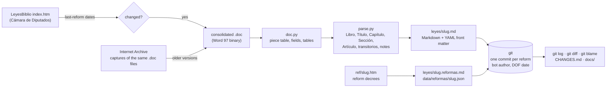

<p align="center">
  
</p>

<p align="center">
  <b>English</b> · <a href="README.es.md">Español</a>
</p>

<p align="center">
  <a href="https://github.com/BEG-lag/leyes-mx/actions/workflows/ci.yml"></a>
  <a href="https://github.com/BEG-lag/leyes-mx/actions/workflows/update.yml"></a>
  <a href="LICENSE"></a>
  <a href="DATA-LICENSE.md"></a>
  
</p>

# leyes-mx

**Mexican federal law, as code.** Every federal law is a clean Markdown file in
git, and every reform published in the *Diario Oficial de la Federación* (DOF)
is a commit dated on the day it was published. So `git log` tells you how a law
changed, `git diff` shows exactly what a reform did, and `git blame` tells you
which reform wrote each paragraph.

<!-- leyes:stats:start -->
**36 laws** · **13,370 articles** · **816 reform decrees** catalogued · **375 versions** in git across 27 laws with history back to 1993 · data as of DOF 07-10-2026
<!-- leyes:stats:end -->

- **For lawyers:** see exactly what a reform changed, link to a single article,
  and read a law as it stood on any date since its first archived version.
- **For developers:** a clean, versioned corpus of Mexican federal law, with
  headings, front matter and reform metadata, ready for search, RAG or analysis.

> [!IMPORTANT]
> Unofficial. Only the Diario Oficial de la Federación is authoritative. Not legal advice.

## See it

<!-- see-it:start -->
The Constitution, reform by reform (44 versions in git):

```console
$ git log --date=short --format='%ad  %h  %s' -- leyes/cpeum.md
2026-10-07  6cd26a9  CPEUM: reforma DOF 07-10-2026
2026-06-02  3e9003b  CPEUM: reformas DOF 10-04-2026 a 02-06-2026
2026-03-03  8f63595  CPEUM: reforma DOF 03-03-2026
2025-10-15  edd95aa  CPEUM: reformas DOF 09-10-2025 a 15-10-2025
2025-04-15  93d32c6  CPEUM: reforma DOF 15-04-2025
2025-04-01  b18e57f  CPEUM: reformas DOF 17-03-2025 a 01-04-2025
2025-01-17  b237612  CPEUM: reformas DOF 20-12-2024 a 17-01-2025
2024-12-02  b5be146  CPEUM: 3 decretos de reforma, DOF 02-12-2024
...
```

What the reform of March 3, 2026 did to article 123, section A, fraction IV (`git show 8f63595`):

```diff
-IV. Por cada seis días de trabajo deberá disfrutar el operario de un día de descanso, cuando menos.
+IV. La jornada laboral será de cuarenta horas semanales en los términos que establezca la Ley.
+
+Por cada seis días de trabajo las personas trabajadoras deberán disfrutar por lo menos de un día de descanso con goce de salario íntegro.
+
+*Fracción reformada DOF 03-03-2026*
```

And which reform wrote that line:

```console
$ git blame --date=short -L '/^IV. La jornada laboral/,+1' leyes/cpeum.md
8f635957 (Diario Oficial (leyes-mx) 2026-03-03) IV. La jornada laboral será de cuarenta horas semanales en los términos que establezca la Ley.
```
<!-- see-it:end -->

## Quickstart

```bash
git clone https://github.com/BEG-lag/leyes-mx && cd leyes-mx
```

**Browse.** Each law is one file in [`leyes/`](leyes/). Every article is a
heading, so it has a stable link, for example
[`leyes/cpeum.md#artículo-27`](leyes/cpeum.md#artículo-27). Next to each law,
`leyes/<slug>.reformas.md` lists every reform decree with its DOF date and a
link to the decree.

**Read the history of a law.** One commit per version, dated with the DOF
publication of the reform it reflects:

```bash
git log --date=short --format='%ad  %s' -- leyes/lft.md
```

**Diff two versions.** By date, at word level, with the bundled CLI or with
plain git:

```bash
uv run leyes diff lft 2019-01-01 2026-06-30 --word      # what changed in between
uv run leyes diff cpeum 2024-01-01 --stat               # summary up to today
git diff "$(git rev-list -1 --before=2019-01-01 HEAD -- leyes/lft.md)" HEAD -- leyes/lft.md
```

**Read the law as it stood on a date.**

```bash
git show "$(git rev-list -1 --before=2012-01-01 HEAD -- leyes/cpeum.md)":leyes/cpeum.md | less
```

**Find which reform wrote a paragraph.**

```bash
git blame --date=short leyes/cpeum.md | grep -m1 'jornada'
```

**Run the pipeline.** Python 3.12+ and [uv](https://docs.astral.sh/uv/):

```bash
uv sync
uv run leyes build lft lse          # download from LeyesBiblio and convert (3 s between requests)
uv run leyes validate --strict      # front matter and article numbering of every law
uv run leyes update --full --commit # what the scheduled workflow runs
uv run leyes history import cpeum   # rebuild a law's history from archived versions
uv run leyes site                   # regenerate CHANGES.md, docs/ and the tables below
uv run pytest
```

## How it works



1. **Sources.** The Cámara de Diputados publishes the consolidated text of
   every federal law in force at
   [LeyesBiblio](https://www.diputados.gob.mx/LeyesBiblio/index.htm), as PDF
   and as Word `.doc`, plus one page per law listing every reform decree. The
   pipeline uses the `.doc`: paragraphs and tables come out exactly as typed,
   without the line-wrapping and page-header noise of PDF extraction.
2. **Parsing Word 97 directly.** [`doc.py`](src/leyes_mx/doc.py) reads the
   binary format itself (OLE container, File Information Block, piece table,
   paragraph properties), drops field codes, and keeps tables as rows of cells.
   No LibreOffice, no network service: the 1.9 MB `.doc` of the Constitution is
   read and structured in under 0.2 s on a laptop.
3. **Structure.** [`parse.py`](src/leyes_mx/parse.py) recognizes the divisions
   each law actually uses and assigns heading levels accordingly; turns every
   article (`1o.`, `3o. Bis`, `15-A`, `353-Ñ`, `228 a`, `199 Sextus`...) into a
   heading; keeps the Cámara's editorial notes (`Párrafo reformado DOF ...`) in
   italics; and keeps the transitorios of the original text and of every reform
   decree.
4. **Validation.** Repealed articles stay in the text (`Se deroga.`), so the
   body must number 1..N with no gaps and no repeats. `leyes validate --strict`
   checks that for every law, in CI.
5. **Commits.** Law text is only ever committed by the bot (below), dated with
   the DOF publication date. A scheduled workflow checks the sources every day
   and commits new reforms the same way.

## Laws included

<!-- leyes:table:start -->
**Constitución**

| Law | Abbr. | Published (DOF) | Last reform (DOF) | Articles | Reform decrees | Versions in git |
|---|---|---|---|---:|---:|---:|
| [Constitución Política de los Estados Unidos Mexicanos](leyes/cpeum.md) | CPEUM | 05-02-1917 | 07-10-2026 | 136 | [285](leyes/cpeum.reformas.md) | 44 |

**Energía (reforma de 2025)**

| Law | Abbr. | Published (DOF) | Last reform (DOF) | Articles | Reform decrees | Versions in git |
|---|---|---|---|---:|---:|---:|
| [Ley del Sector Eléctrico](leyes/lse.md) | LSE | 18-03-2025 | none | 188 | [0](leyes/lse.reformas.md) | 1 |
| [Ley del Sector Hidrocarburos](leyes/lsh.md) | LSH | 18-03-2025 | none | 166 | [0](leyes/lsh.reformas.md) | 1 |
| [Ley de la Empresa Pública del Estado, Comisión Federal de Electricidad](leyes/lepecfe.md) | LEPECFE | 18-03-2025 | none | 131 | [0](leyes/lepecfe.reformas.md) | 1 |
| [Ley de la Empresa Pública del Estado, Petróleos Mexicanos](leyes/lepepm.md) | LEPEPM | 18-03-2025 | none | 126 | [0](leyes/lepepm.reformas.md) | 1 |
| [Ley de la Comisión Nacional de Energía](leyes/lcne.md) | LCNE | 18-03-2025 | 26-12-2025 | 28 | [0](leyes/lcne.reformas.md) | 1 |
| [Ley de Planeación y Transición Energética](leyes/lpte.md) | LPTE | 18-03-2025 | none | 100 | [0](leyes/lpte.reformas.md) | 1 |
| [Ley de Biocombustibles](leyes/lbio.md) | LBio | 18-03-2025 | none | 46 | [0](leyes/lbio.reformas.md) | 1 |
| [Ley de Geotermia](leyes/lgeo.md) | LGeo | 18-03-2025 | none | 66 | [0](leyes/lgeo.reformas.md) | 1 |
| [Ley de Ingresos sobre Hidrocarburos](leyes/lih.md) | LIH | 11-08-2014 | 28-12-2025 | 64 | [1](leyes/lih.reformas.md) | 10 |
| [Ley de la Agencia Nacional de Seguridad Industrial y de Protección al Medio Ambiente del Sector Hidrocarburos](leyes/lansi.md) | LANSI | 11-08-2014 | 11-05-2022 | 38 | [0](leyes/lansi.reformas.md) | 3 |

**Minería, agua, tierra y ambiente**

| Law | Abbr. | Published (DOF) | Last reform (DOF) | Articles | Reform decrees | Versions in git |
|---|---|---|---|---:|---:|---:|
| [Ley de Minería](leyes/lmin.md) | LMin | 26-06-1992 | 08-05-2023 | 79 | [2](leyes/lmin.reformas.md) | 4 |
| [Ley de Aguas Nacionales](leyes/lan.md) | LAN | 01-12-1992 | 11-12-2025 | 215 | [5](leyes/lan.reformas.md) | 11 |
| [Ley General de Aguas](leyes/lgag.md) | LGAg | 11-12-2025 | none | 45 | [0](leyes/lgag.reformas.md) | 1 |
| [Ley General del Equilibrio Ecológico y la Protección al Ambiente](leyes/lgeepa.md) | LGEEPA | 28-01-1988 | 19-01-2026 | 270 | [33](leyes/lgeepa.reformas.md) | 21 |
| [Ley Agraria](leyes/lagra.md) | LAgra | 26-02-1992 | 14-11-2025 | 201 | [5](leyes/lagra.reformas.md) | 10 |

**Empresa, comercio y competencia**

| Law | Abbr. | Published (DOF) | Last reform (DOF) | Articles | Reform decrees | Versions in git |
|---|---|---|---|---:|---:|---:|
| [Código de Comercio](leyes/ccom.md) | CCom | 07-10-1889 | 18-02-2026 | 1,641 | [49](leyes/ccom.reformas.md) | 20 |
| [Ley General de Sociedades Mercantiles](leyes/lgsm.md) | LGSM | 04-08-1934 | 26-12-2025 | 277 | [12](leyes/lgsm.reformas.md) | 10 |
| [Ley General de Títulos y Operaciones de Crédito](leyes/lgtoc.md) | LGTOC | 27-08-1932 | 26-03-2024 | 463 | [21](leyes/lgtoc.reformas.md) | 8 |
| [Ley de Inversión Extranjera](leyes/lie.md) | LIE | 27-12-1993 | 27-05-2024 | 42 | [8](leyes/lie.reformas.md) | 10 |
| [Ley Federal de Competencia Económica](leyes/lfce.md) | LFCE | 23-05-2014 | 14-11-2025 | 153 | [1](leyes/lfce.reformas.md) | 4 |
| [Ley Federal de Protección al Consumidor](leyes/lfpc.md) | LFPC | 24-12-1992 | 23-12-2025 | 190 | [24](leyes/lfpc.reformas.md) | 27 |

**Propiedad intelectual y datos personales**

| Law | Abbr. | Published (DOF) | Last reform (DOF) | Articles | Reform decrees | Versions in git |
|---|---|---|---|---:|---:|---:|
| [Ley Federal del Derecho de Autor](leyes/lfda.md) | LFDA | 24-12-1996 | 14-05-2026 | 259 | [6](leyes/lfda.reformas.md) | 10 |
| [Ley Federal de Protección a la Propiedad Industrial](leyes/lfppi.md) | LFPPI | 01-07-2020 | 03-04-2026 | 421 | [2](leyes/lfppi.reformas.md) | 2 |
| [Ley Federal de Protección de Datos Personales en Posesión de los Particulares](leyes/lfpdppp.md) | LFPDPPP | 20-03-2025 | 14-11-2025 | 64 | [0](leyes/lfpdppp.reformas.md) | 2 |

**Trabajo, civil, amparo y procedimiento**

| Law | Abbr. | Published (DOF) | Last reform (DOF) | Articles | Reform decrees | Versions in git |
|---|---|---|---|---:|---:|---:|
| [Ley Federal del Trabajo](leyes/lft.md) | LFT | 01-04-1970 | 14-05-2026 | 1,266 | [54](leyes/lft.reformas.md) | 14 |
| [Código Civil Federal](leyes/ccf.md) | CCF | 26-05-1928 | 14-11-2025 | 3,103 | [57](leyes/ccf.reformas.md) | 14 |
| [Ley de Amparo, Reglamentaria de los artículos 103 y 107 de la Constitución Política de los Estados Unidos Mexicanos](leyes/lamp.md) | LAmp | 02-04-2013 | 16-10-2025 | 272 | [2](leyes/lamp.reformas.md) | 11 |
| [Código Nacional de Procedimientos Civiles y Familiares](leyes/cnpcf.md) | CNPCF | 07-06-2023 | 15-01-2026 | 1,191 | [2](leyes/cnpcf.reformas.md) | 4 |

**Administración pública, fiscal y penal**

| Law | Abbr. | Published (DOF) | Last reform (DOF) | Articles | Reform decrees | Versions in git |
|---|---|---|---|---:|---:|---:|
| [Ley Orgánica de la Administración Pública Federal](leyes/loapf.md) | LOAPF | 29-12-1976 | 07-05-2026 | 72 | [47](leyes/loapf.reformas.md) | 30 |
| [Ley Federal de Procedimiento Administrativo](leyes/lfpa.md) | LFPA | 04-08-1994 | 14-11-2025 | 119 | [2](leyes/lfpa.reformas.md) | 5 |
| [Ley General de Responsabilidades Administrativas](leyes/lgra.md) | LGRA | 18-07-2016 | 15-12-2025 | 235 | [4](leyes/lgra.reformas.md) | 9 |
| [Código Fiscal de la Federación](leyes/cff.md) | CFF | 31-12-1981 | 09-04-2026 | 421 | [56](leyes/cff.reformas.md) | 27 |
| [Ley del Impuesto sobre la Renta](leyes/lisr.md) | LISR | 11-12-2013 | 01-04-2024 | 236 | [2](leyes/lisr.reformas.md) | 7 |
| [Código Penal Federal](leyes/cpf.md) | CPF | 14-08-1931 | 13-03-2026 | 556 | [128](leyes/cpf.reformas.md) | 36 |
| [Código Nacional de Procedimientos Penales](leyes/cnpp.md) | CNPP | 05-03-2014 | 28-11-2025 | 490 | [8](leyes/cnpp.reformas.md) | 13 |
<!-- leyes:table:end -->

The list lives in [`catalog.yml`](catalog.yml); adding a law is one line.

## Where the history comes from

LeyesBiblio only serves the *current* text of each law. But the
[Internet Archive](https://web.archive.org/) has been capturing those same
`.doc` files since 2006, under the three naming schemes the Cámara has used
(`doc/125.doc`, then `doc/125_120615.doc`, now `doc/LFT.doc`).
`leyes history` recovers the old file names from archived copies of the
index, lists every capture through the public CDX API, downloads each distinct
file once, reads its *Última reforma publicada DOF dd-mm-yyyy* header and keeps
one version per reform date. Each commit groups the reforms published
between two archived copies of the source and is dated with the latest of
them. Dates are those of the DOF publication the text
reflects, not of the capture: the oldest captures are from 2006, and some of
them hold texts last reformed years earlier (the Ley Agraria captured in 2006
had not changed since 1993, so its history starts there).

<!-- history:start -->
Result: **375 versions** in git. 27 of 36 laws have more than one version; the oldest dates from 1993. Per-law detail in [`data/historia/`](data/historia/).

| Law | Versions | Since |
|---|---:|---|
| [CPEUM](https://github.com/BEG-lag/leyes-mx/commits/main/leyes/cpeum.md) · Constitución Política de los Estados Unidos Mexicanos | 44 | 2006-04-07 |
| [CPF](https://github.com/BEG-lag/leyes-mx/commits/main/leyes/cpf.md) · Código Penal Federal | 36 | 2006-06-30 |
| [LOAPF](https://github.com/BEG-lag/leyes-mx/commits/main/leyes/loapf.md) · Ley Orgánica de la Administración Pública Federal | 30 | 2006-06-02 |
| [CFF](https://github.com/BEG-lag/leyes-mx/commits/main/leyes/cff.md) · Código Fiscal de la Federación | 27 | 2006-05-12 |
| [LFPC](https://github.com/BEG-lag/leyes-mx/commits/main/leyes/lfpc.md) · Ley Federal de Protección al Consumidor | 27 | 2006-06-06 |
| [LGEEPA](https://github.com/BEG-lag/leyes-mx/commits/main/leyes/lgeepa.md) · Ley General del Equilibrio Ecológico y la Protección al Ambiente | 21 | 2006-05-23 |
| [CCom](https://github.com/BEG-lag/leyes-mx/commits/main/leyes/ccom.md) · Código de Comercio | 20 | 2006-06-06 |
| [CCF](https://github.com/BEG-lag/leyes-mx/commits/main/leyes/ccf.md) · Código Civil Federal | 14 | 2004-12-31 |
| [LFT](https://github.com/BEG-lag/leyes-mx/commits/main/leyes/lft.md) · Ley Federal del Trabajo | 14 | 2006-01-17 |
| [CNPP](https://github.com/BEG-lag/leyes-mx/commits/main/leyes/cnpp.md) · Código Nacional de Procedimientos Penales | 13 | 2014-03-05 |
| [LAmp](https://github.com/BEG-lag/leyes-mx/commits/main/leyes/lamp.md) · Ley de Amparo, Reglamentaria de los artículos 103 y 107 de la Constitución Política de los Estados Unidos Mexicanos | 11 | 2013-04-02 |
| [LAN](https://github.com/BEG-lag/leyes-mx/commits/main/leyes/lan.md) · Ley de Aguas Nacionales | 11 | 2004-04-29 |
| [LAgra](https://github.com/BEG-lag/leyes-mx/commits/main/leyes/lagra.md) · Ley Agraria | 10 | 1993-07-09 |
| [LFDA](https://github.com/BEG-lag/leyes-mx/commits/main/leyes/lfda.md) · Ley Federal del Derecho de Autor | 10 | 2003-07-23 |
| [LGSM](https://github.com/BEG-lag/leyes-mx/commits/main/leyes/lgsm.md) · Ley General de Sociedades Mercantiles | 10 | 2006-07-28 |
| [LIE](https://github.com/BEG-lag/leyes-mx/commits/main/leyes/lie.md) · Ley de Inversión Extranjera | 10 | 2006-07-18 |
| [LIH](https://github.com/BEG-lag/leyes-mx/commits/main/leyes/lih.md) · Ley de Ingresos sobre Hidrocarburos | 10 | 2014-08-11 |
| [LGRA](https://github.com/BEG-lag/leyes-mx/commits/main/leyes/lgra.md) · Ley General de Responsabilidades Administrativas | 9 | 2016-07-18 |
| [LGTOC](https://github.com/BEG-lag/leyes-mx/commits/main/leyes/lgtoc.md) · Ley General de Títulos y Operaciones de Crédito | 8 | 2006-07-18 |
| [LISR](https://github.com/BEG-lag/leyes-mx/commits/main/leyes/lisr.md) · Ley del Impuesto sobre la Renta | 7 | 2013-12-11 |
| [LFPA](https://github.com/BEG-lag/leyes-mx/commits/main/leyes/lfpa.md) · Ley Federal de Procedimiento Administrativo | 5 | 2000-05-30 |
| [CNPCF](https://github.com/BEG-lag/leyes-mx/commits/main/leyes/cnpcf.md) · Código Nacional de Procedimientos Civiles y Familiares | 4 | 2023-06-07 |
| [LFCE](https://github.com/BEG-lag/leyes-mx/commits/main/leyes/lfce.md) · Ley Federal de Competencia Económica | 4 | 2014-05-23 |
| [LMin](https://github.com/BEG-lag/leyes-mx/commits/main/leyes/lmin.md) · Ley de Minería | 4 | 2006-06-26 |
| [LANSI](https://github.com/BEG-lag/leyes-mx/commits/main/leyes/lansi.md) · Ley de la Agencia Nacional de Seguridad Industrial y de Protección al Medio Ambiente del Sector Hidrocarburos | 3 | 2014-08-11 |
| [LFPDPPP](https://github.com/BEG-lag/leyes-mx/commits/main/leyes/lfpdppp.md) · Ley Federal de Protección de Datos Personales en Posesión de los Particulares | 2 | 2025-03-20 |
| [LFPPI](https://github.com/BEG-lag/leyes-mx/commits/main/leyes/lfppi.md) · Ley Federal de Protección a la Propiedad Industrial | 2 | 2020-07-01 |
<!-- history:end -->

**Who commits what.** Every commit that records a version of a law is authored
*and* committed by `Diario Oficial (leyes-mx) <dof@leyes-mx.invalid>`, with
`GIT_AUTHOR_DATE` and `GIT_COMMITTER_DATE` set to noon (Mexico City) of the DOF
publication date. The messages cite the decree title, its DOF date and a link
to it, plus the consolidated source and the archived copy. The merge that
brought the history in and the generated data refreshes are also the bot's,
with their real dates. The tooling and documentation commits are the
author's, with their real dates. That keeps the legal timeline in
`git log` and `git blame` without attributing backdated activity to a person.

**How the two histories meet.** The tooling lives on `main` from its first
commit. The reconstructed law history was built as a separate root (one commit
per version, oldest first, across all laws) and merged into `main` once. So
`git log -- leyes/cpeum.md` walks back through the Constitution's reforms,
`git log --first-parent` shows how the project itself was built, and future
imports of more laws can be merged the same way without rewriting anything.

## Limitations

- **Unofficial and derived.** The texts are the Cámara de Diputados'
  consolidated versions, not the DOF itself. Consolidation can contain errors;
  the DOF prevails.
- **Partial history.** Old versions exist only where the Internet Archive
  captured the file. When several reforms fall between two captures, one
  commit carries all of them and its message says so. Laws enacted in 2025
  start at their publication.
- **Index and file can disagree.** The date shown is the one printed in the
  document header. The Cámara sometimes updates its index before the file: as
  of this snapshot the index lists a reform of the Ley del Impuesto sobre la
  Renta of 13-11-2026 that the downloadable file does not include yet. The
  Monday full check (hash comparison) picks such changes up when they land.
- **Source quirks in old versions.** 14 of the 375 versions in git show
  article-numbering anomalies that come from the archived files: 13 old
  Códigos de Comercio type article 291 as `29l`, and the 2014 copy of the Ley
  Federal de Competencia Económica bundles articles of another law from the
  same decree. Every current text passes `leyes validate --strict`.
- **Formatting.** Bold and italics from Word are not preserved (editorial
  notes are rendered in italics on purpose); images, scanned annexes and
  formulas are not included; tables are kept as Markdown tables.
- **Scope.** Federal laws and codes only: no regulations, NOMs, state law or
  case law. The SCJN legislation portal was evaluated and not used: it sits
  behind bot protection and session-based forms, and this project does not
  scrape around that.
- **Transitorios** are kept as text with bold labels rather than headings, so
  the outline of each file stays readable.
- **Size.** The largest codes are 0.7 to 1.3 MB of Markdown. GitHub renders
  files of that size, but if the rich view ever times out, use *Raw*, the
  [docs page](docs/) or a local clone.

## Repository layout

```text
leyes/                  one Markdown file per law + its reform timeline
data/reformas/          reform decrees per law (JSON, from LeyesBiblio)
data/historia/          which archived file became which version (JSON)
src/leyes_mx/           doc.py, parse.py, sources.py, wayback.py, history.py, cli.py ...
tests/                  pytest suite (parser, sources, git history)
docs/                   static index page (GitHub Pages ready)
CHANGES.md              recent reforms across all tracked laws
catalog.yml             the curated list of laws
```

## Politeness

The pipeline identifies itself with a generic `leyes-mx/0.1` User-Agent that
points to this repository, waits 3 seconds between requests to the same host
(the Cámara de Diputados and the Internet Archive alike), uses timeouts, and
retries with exponential backoff. The daily job downloads one index page; files are downloaded only for
laws whose date changed (plus a full hash check on Mondays).

## Disclaimer

Unofficial. Only the Diario Oficial de la Federación is authoritative. Not
legal advice. This project is not affiliated with the Cámara de Diputados, the
DOF or the Internet Archive.

## License

Code: [MIT](LICENSE). Law texts: excluded from copyright protection by article
14, fraction VIII, of the Ley Federal del Derecho de Autor; anything this
project adds to the data is dedicated to the public domain (CC0). See
[DATA-LICENSE.md](DATA-LICENSE.md), which quotes the article. That is the
author's reading of the law, not legal advice.

## Author

**Benjamín Esponda García**, corporate lawyer in Mexico City (energy,
hydrocarbons and mining, about eight years in practice) who builds legal tools
with AI. This repository is the kind of thing a lawyer wants and a developer
can maintain: the law as data, with its history intact.

[pivotek.mx](https://pivotek.mx) · [AI portfolio](https://github.com/BEG-lag/portafolio-ia) · [@BEG-lag](https://github.com/BEG-lag)
